# Network flow with Tailscale

```mermaid
flowchart LR
  subgraph MAC["Mac"]
    CC["Claude Code<br/>(HTTP transport)"]
    CD["Claude Desktop → mcp-remote<br/>(stdio↔HTTP bridge)"]
    DNS["MagicDNS<br/>nas.&lt;tailnet&gt;.ts.net → NAS 100.x.y.z"]
    TSM["tailscaled (Mac)<br/>WireGuard encrypt"]
    CC --> DNS
    CD --> DNS
    DNS --> TSM
  end

  subgraph PATH["Transport"]
    direction TB
    P2P["Direct UDP peer-to-peer<br/>(LAN at home, NAT traversal away)"]
    DERP["DERP relay<br/>(fallback, still end-to-end encrypted)"]
  end

  CTRL["Tailscale control plane<br/>(login, keys, policy push;<br/>no data traffic)"]

  subgraph NAS["Synology NAS (host)"]
    TSN["tailscaled (DSM package)<br/>WireGuard decrypt"]
    ACL{"Policy check<br/>src = Mac?<br/>dst port = &lt;port&gt;?"}
    DROP["Dropped<br/>(DSM 5000/5001, other ports,<br/>other devices)"]
    HP["Host port &lt;port&gt;"]
    DNAT["Docker port mapping<br/>&lt;port&gt; → container 8080"]
    subgraph CT["nas-mcp container (non-root user)"]
      HTTP["Node HTTP server<br/>0.0.0.0:8080 /mcp"]
      AUTH{"Bearer token<br/>valid?"}
      R401["401"]
      TOOLS["MCP tools<br/>list, read, write, move, delete, …"]
      DATA["/data/&lt;Mount&gt;"]
    end
    VOL["/volume1/&lt;shared folder&gt;<br/>(bind mounts)"]
  end

  TSM --> P2P --> TSN
  TSM -.-> DERP -.-> TSN
  CTRL -.->|policy + keys| TSM
  CTRL -.->|policy + keys| TSN
  TSN --> ACL
  ACL -- no --> DROP
  ACL -- yes --> HP --> DNAT --> HTTP --> AUTH
  AUTH -- no --> R401
  AUTH -- yes --> TOOLS --> DATA --> VOL
```

How a request from the Mac reaches the server when using remote access ([README §9](../README.md#9-remote-access-tailscale-optional), [ADR-0002](adr/0002-lan-only-static-bearer-token.md)). Tailscale runs on the NAS host (the DSM package), not in the container; the container only sees plain TCP on its published port. `<port>` is your `NAS_MCP_HOST_PORT`.

- **Two independent gates.** The tailnet policy decides who reaches the NAS and on which port (only the Mac, only `<port>`); the bearer token decides who may use MCP.
- **Encryption.** Plain HTTP inside WireGuard, encrypted from the Mac to `tailscaled` on the NAS. The last hop (host → container) is unencrypted but never leaves the NAS.
- **Control plane vs data.** Tailscale's servers handle login, key exchange and policy distribution only. File data goes Mac → NAS directly, or through a DERP relay when no direct path exists; relays can't decrypt it.
- **At home.** The `ts.net` URL still goes through the tailnet, normally peer-to-peer over the LAN. The LAN URL (`http://<nas LAN IP>:<port>/mcp`) bypasses Tailscale.
- **DSM over the tailnet** times out by design (blocked by the policy); use the LAN for DSM admin.
- **Userspace networking.** The Synology package often runs `tailscaled` in userspace mode; it then terminates incoming TCP itself and re-dials the local `<port>`. Same path and outcome as the diagram.
- **Out of reach.** claude.ai web/mobile and Claude Desktop's built-in Connectors connect from Anthropic's cloud, which can't join the tailnet. Only clients running on the Mac work.
